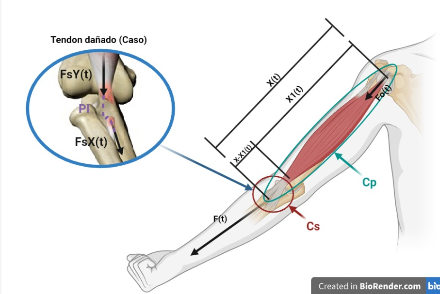

[](https://matlab.mathworks.com/open/github/v1?repo=l24210589-ops/MSFP3)
# Práctica 3 — Modelado y control del sistema musculoesquelético

Repositorio académico de la asignatura **Modelado de Sistemas Fisiológicos**, correspondiente al programa de **Ingeniería Biomédica** del Tecnológico Nacional de México / Instituto Tecnológico de Tijuana. Esta práctica integra analogías electromecánicas, modelado matemático, análisis temporal y de estabilidad, simulación en MATLAB/Simulink y Python, y diseño de un controlador PI *in silico*.

El caso de estudio representa un **compartimento musculoesquelético** mediante un modelo mecánico viscoelástico (elementos $C_p$, $C_s$ y $R$ más el elemento contráctil $F_0$), convertido a un **circuito eléctrico equivalente** con la analogía fuerza–voltaje. Se compara la respuesta de un individuo sano (**control**) con la de un caso simulado de atrofia muscular (**caso**) y se diseña un controlador que acerque la respuesta del caso a la del control.

**Docente:** Dr. Paul Antonio Valle Trujillo  
**Correo:** paul.valle@tectijuana.edu.mx  
**Departamento:** Ingeniería Eléctrica y Electrónica  
**Institución:** Tecnológico Nacional de México / Instituto Tecnológico de Tijuana  
**Asignatura:** Modelado de Sistemas Fisiológicos  
**Programa:** Ingeniería Biomédica  
**Estudiante:** Morales Díaz Ramón Iván · 24210589 · l24210589@tectijuana.edu.mx

**Repositorio de la asignatura:** https://github.com/DrPaulValle/MSF-IBF1020  
**Sede:** Blvd. Alberto Limón Padilla s/n, Tijuana, C. P. 22454, B. C., México.

---

<a id="contenido"></a>
## Contenido

1. [Resumen](#resumen)
2. [Competencia y objetivos](#objetivos)
3. [Relación con el temario](#temario)
4. [Modelo físico y analogía eléctrica](#analogia)
5. [Formulación matemática](#modelo)
6. [Análisis temporal y de estabilidad](#analisis)
7. [Condiciones de simulación y señales](#senales)
8. [Implementación en MATLAB y Simulink](#matlab)
9. [Control en lazo cerrado con PI](#pid)
10. [Reproducción en Python](#python)
11. [Resultados y verificación cruzada](#resultados)
12. [Actividades del estudiante](#actividades)
13. [Estructura del repositorio](#estructura)
14. [Requisitos](#requisitos)
15. [Reproducibilidad y entregables](#reproducibilidad)
16. [Referencias](#referencias)

---

<a id="resumen"></a>
## Resumen

La práctica modela las propiedades viscoelásticas del sistema musculoesquelético con un circuito eléctrico de **tres elementos pasivos** ($C_p$, $C_s$ y $R$) y una fuente dependiente $F_0(t)=\alpha F(t)$ que representa la fuerza del elemento contráctil activo. Mediante **superposición** se obtiene la fuerza transmitida $F_s(t)$ y su función de transferencia $F_s(s)/F(s)$; el modelo se reescribe como una **ecuación diferencial ordinaria de primer orden** con una variable de estado auxiliar $x(t)$ y una ecuación algebraica de salida.

Se comparan dos individuos que difieren **únicamente en la resistencia $R$**: control ($R=100\,\Omega$) y caso ($R=10\,\mathrm{k}\Omega$). Ante un pulso de fuerza de $1\,\mathrm{V}$ entre $t=1\,\mathrm{s}$ y $t=2\,\mathrm{s}$, ambos tienen el mismo valor final pero el caso responde unas 100 veces más lento. Para reducir esa diferencia se diseña un **controlador PI con retroalimentación negativa** que toma la respuesta del control como referencia. Los resultados se obtienen con MATLAB/Simulink (modelo `Sistemas.slx`), se comprueban con una integración numérica propia del modelo de EDOs y se reproducen en Python.

**Palabras clave:** circuito RLC; controlador PID; mecánica pulmonar; modelado de sistemas fisiológicos; MATLAB; Simulink; Simscape Electrical; Python; simulación *in silico*; instrumentación electrónica.

[Volver al contenido](#contenido)

---

<a id="objetivos"></a>
## Competencia y objetivos

### Competencia a desarrollar

Modelar sistemas fisiológicos mediante analogías entre sistemas físicos, ecuaciones diferenciales y funciones de transferencia para analizar su comportamiento dinámico y diseñar estrategias de control mediante técnicas de control clásico. En particular, el estudiante analiza un modelo mecánico simplificado del sistema musculoesquelético, construye su circuito eléctrico equivalente mediante la analogía fuerza–voltaje, compara la respuesta de un individuo sano (*control*) con un caso simulado de atrofia muscular (*caso*) y diseña una estrategia de control *in silico* orientada a reducir las diferencias entre ambas respuestas.

### Objetivo general

Analizar, simular y controlar el modelo mecánico del sistema musculoesquelético para las condiciones control y caso, y diseñar un controlador que acerque la fuerza transmitida del caso a la del individuo de referencia.

### Objetivos específicos

- Interpretar el modelo mecánico y transformarlo en un circuito eléctrico equivalente mediante la analogía fuerza–voltaje.
- Obtener la función de transferencia $F_s(s)/F(s)$ mediante el principio de superposición y la transformada de Laplace.
- Formular el modelo como una EDO de primer orden con su ecuación de salida.
- Calcular el valor final, el error en estado estacionario, el polo y el cero de cada individuo.
- Simular control y caso en Simulink con el circuito equivalente (Simscape Electrical) y con la función de transferencia.
- Diseñar y sintonizar un controlador con retroalimentación negativa que tome al control como referencia.
- Integrar numéricamente el modelo de EDOs en MATLAB y compararlo con Simulink.
- Reproducir las respuestas en Python con las mismas ganancias.
- Documentar los resultados en un repositorio de GitHub.

[Volver al contenido](#contenido)

---

<a id="temario"></a>
## Relación con el temario

La práctica integra contenidos de tres unidades de la asignatura **Modelado de Sistemas Fisiológicos (IBF-1020)**:

| Unidad | Área | Contenidos aplicados |
|---|---|---|
| I | Sistemas de control retroalimentados | Diagramas de bloques, señal de error, lazo abierto y cerrado, error en estado estacionario y estabilidad |
| II | Modelado matemático | Analogías electromecánicas, superposición, ecuaciones diferenciales y función de transferencia |
| III | Controladores | Diseño del controlador y sintonización de ganancias |

[Volver al contenido](#contenido)

---

<a id="analogia"></a>
## Modelo físico y analogía eléctrica

Los modelos mecánicos son una herramienta para representar las propiedades viscoelásticas del sistema musculoesquelético: combinando elementos contráctiles, resortes y amortiguadores se describe de forma simplificada la relación entre la fuerza del músculo, su deformación y las propiedades de los tejidos y tendones. La figura muestra el esquema del modelo sobre el brazo, con el tendón dañado que representa al caso.



*Esquema elaborado en BioRender: el elemento paralelo $C_p$ (músculo), el elemento en serie $C_s$ (tendón), el desplazamiento total $x(t)$, el desplazamiento $x_1(t)$ de $C_s$ y la deformación del amortiguador $x(t)-x_1(t)$. En el recuadro, $F_{sX}(t)$ es la fuerza transmitida del control y $F_{sY}(t)$ la del caso (tendón dañado).*

### Elementos del modelo

| Símbolo | Interpretación fisiológica |
|---|---|
| $F(t)$ | Fuerza transmitida por el sistema después de considerar sus propiedades mecánicas |
| $F_0(t)$ | Fuerza desarrollada por el elemento contráctil activo; $F_0(t)=\alpha F(t)$, con $0<\alpha<1$ |
| $R$ | Amortiguación viscosa inherente al tejido |
| $C_p$ | Elasticidad del elemento paralelo (sarcolema y estructuras musculares pasivas) |
| $C_s$ | Elasticidad del elemento en serie (tendones) |
| $x(t)$ | Desplazamiento del elemento paralelo $C_p$ |
| $x_1(t)$ | Desplazamiento del elemento en serie $C_s$ |
| $x(t)-x_1(t)$ | Deformación del amortiguador (su derivada es la velocidad relativa del elemento) |
| $F_s(t)$ | Fuerza transmitida de salida (nodo de $C_p$) |

### Analogía fuerza–voltaje

| Sistema mecánico | Sistema eléctrico equivalente |
|---|---|
| Fuerza $F(t)$ | Voltaje $V(t)$ |
| Velocidad $dx(t)/dt$ | Corriente $I(t)$ |
| Desplazamiento $x(t)$ | Carga eléctrica $q(t)$ |
| Amortiguador | Resistencia $R$ |
| Compliancia mecánica | Capacitancia $C$ |
| Masa | Inductancia $L$ |

Las conexiones mecánicas y eléctricas no conservan necesariamente la misma topología: elementos mecánicos en paralelo pueden representarse como elementos eléctricos en serie, y viceversa. La ubicación de $x(t)$ y $x_1(t)$ determina los nodos y ramas del circuito equivalente.

### Parámetros del circuito equivalente

| Parámetro | Control | Caso |
|---|---:|---:|
| $F(t)$ | 1 V | 1 V |
| $\alpha$ | 0.25 | 0.25 |
| $C_s$ | 10 µF | 10 µF |
| $C_p$ | 100 µF | 100 µF |
| $R$ | 100 Ω | 10 kΩ |

La diferencia entre control y caso se representa **solo con el incremento de $R$**, que modifica la componente viscosa del modelo y produce una respuesta mecánica distinta. Las variables de fuerza se expresan en voltios durante la simulación eléctrica.

[Volver al contenido](#contenido)

---

<a id="modelo"></a>
## Formulación matemática

El análisis se hizo a mano y se resume a continuación; el desarrollo completo está en el PDF [`AnalisisMate.pdf`](AnalisisMate.pdf).

### 1. Relaciones del modelo

La fuerza de salida es la suma de las contribuciones de las dos fuentes (superposición):

$$
F_s(t)=F_{s_1}(t)+F_{s_2}(t),
$$

donde $F_{s_1}$ se obtiene con $F_0(t)$ apagada y $F_{s_2}$ con $F(t)$ apagada.

### 2. Circuito 1: apagando $F_0(t)$

Con $x(t)=x_1(t)+x_2(t)$ y la corriente del capacitor $C_p$ igual a $x(t)$:

$$
x(t)=C_p\frac{dF_{s_1}(t)}{dt},\qquad
x_1(t)=C_s\frac{d\left[F(t)-F_{s_1}(t)\right]}{dt},\qquad
x_2(t)=\frac{F(t)-F_{s_1}(t)}{R}.
$$

Igualando $x=x_1+x_2$ y aplicando Laplace con condiciones iniciales nulas:

$$
C_psF_{s_1}(s)=C_ss\left[F(s)-F_{s_1}(s)\right]+\frac{F(s)-F_{s_1}(s)}{R},
$$

$$
\left[R(C_p+C_s)s+1\right]F_{s_1}(s)=\left(RC_ss+1\right)F(s),
$$

$$
\frac{F_{s_1}(s)}{F(s)}=\frac{RC_ss+1}{R(C_p+C_s)s+1}.
$$

### 3. Circuito 2: apagando $F(t)$

Con $F(t)$ apagada, $C_s$ y $C_p$ quedan en paralelo (capacitancia $C_p+C_s$), en serie con $R$ y con la fuente $F_0=\alpha F$ (de polaridad opuesta):

$$
-\alpha F(t)=R\,x(t)+\frac{1}{C_p+C_s}\int x(t)\,dt,\qquad
F_{s_2}(t)=\frac{1}{C_p+C_s}\int x(t)\,dt.
$$

En el dominio de Laplace, $-\alpha F(s)=\left[R+\dfrac{1}{(C_p+C_s)s}\right]X(s)$ y $F_{s_2}(s)=\dfrac{X(s)}{(C_p+C_s)s}$, de donde

$$
\frac{F_{s_2}(s)}{F(s)}=\frac{-\alpha}{R(C_p+C_s)s+1}.
$$

### 4. Función de transferencia

Sumando ambas contribuciones:

$$
\boxed{G(s)=\frac{F_s(s)}{F(s)}=\frac{RC_s\,s+1-\alpha}{R(C_p+C_s)\,s+1}.}
$$

### 5. Modelo de EDO

Se definen la constante de tiempo y el coeficiente de transmisión directa

$$
\tau=R(C_p+C_s),\qquad \beta=\frac{C_s}{C_p+C_s}.
$$

Se introduce la variable de estado auxiliar $x(t)$ con $X(s)=\dfrac{F(s)}{\tau s+1}$, por lo que

$$
\frac{dx(t)}{dt}=-\frac{x(t)}{\tau}+\frac{F(t)}{\tau},
$$

y la salida se recupera con

$$
F_s(s)=\beta F(s)+X(s)(1-\alpha-\beta),\qquad
F_s(t)=\beta F(t)+x(t)(1-\alpha-\beta).
$$

Sustituyendo los coeficientes se obtiene el **modelo de EDO** utilizado en la práctica:

$$
\boxed{
\begin{aligned}
\frac{dx(t)}{dt}&=-\frac{x(t)}{R(C_p+C_s)}+\frac{F(t)}{R(C_p+C_s)},\\[4pt]
F_s(t)&=\frac{C_s}{C_p+C_s}\,F(t)+x(t)\left(1-\alpha-\frac{C_s}{C_p+C_s}\right),
\end{aligned}}
$$

con $x(0)=0$.

### 6. Comprobación de la equivalencia

Combinando la ecuación de estado con la de salida:

$$
\frac{F_s(s)}{F(s)}=\beta+\frac{1-\alpha-\beta}{\tau s+1}=\frac{\beta\tau\,s+1-\alpha}{\tau s+1}=\frac{RC_s\,s+1-\alpha}{R(C_p+C_s)\,s+1},
$$

ya que $\beta\tau=RC_s$. Es la misma función de transferencia obtenida por superposición.

[Volver al contenido](#contenido)

---

<a id="analisis"></a>
## Análisis temporal y de estabilidad

### 1. Valor final y error en estado estacionario

La ganancia en continua es $G(0)=1-\alpha=0.75$ para ambos individuos. Ante una entrada escalón unitario:

$$
e_{ss}=\lim_{s\to0}sF(s)\left[1-G(s)\right]=1-G(0)=\alpha=0.25.
$$

Control y caso tienen **el mismo valor final** ($0.75\,\mathrm{V}$ por cada $1\,\mathrm{V}$ aplicado) y difieren solo en la rapidez con que lo alcanzan.

### 2. Polo, cero y estabilidad

El denominador es de primer orden (un único elemento de almacenamiento independiente, $C_p+C_s$), con polo en $s=-1/\tau$ y un cero en $s=-(1-\alpha)/(RC_s)$. La respuesta inicial es un salto de $G(\infty)=\beta=0.0909$.

| Individuo | $R$ | $\tau=R(C_p+C_s)$ | Polo [s⁻¹] | Cero [s⁻¹] | $F_s$ en $t=2\,\mathrm{s}$ |
|---|---:|---:|---:|---:|---:|
| Control | 100 Ω | 0.011 s | $-90.909$ | $-750$ | 0.750 V (valor final) |
| Caso | 10 kΩ | 1.1 s | $-0.909$ | $-7.5$ | 0.484 V |

Ambos polos son reales negativos, por lo que los dos sistemas son estables. El control alcanza su valor final en unos $4\tau\approx0.044\,\mathrm{s}$; el caso apenas llega a $0.484\,\mathrm{V}$ al terminar el pulso y después decae con constante de tiempo de $1.1\,\mathrm{s}$.

[Volver al contenido](#contenido)

---

<a id="senales"></a>
## Condiciones de simulación y señales

| Parámetro | MATLAB/Simulink | EDOs en MATLAB | Python |
|---|---|---|---|
| Intervalo | $0\le t\le10\,\mathrm{s}$ (`StopTime = 10`) | $0\le t\le10\,\mathrm{s}$ | $0\le t\le10\,\mathrm{s}$ |
| Paso | `MaxStep = 1e-3` s | $\Delta t=10^{-3}$ s | $\Delta t=10^{-3}$ s ($N=10001$) |
| Método | `ode15s` | Euler explícito | `control.forced_response` |
| Condiciones iniciales | Nulas | $x(0)=0$, $F_s(0)=0$ | $x_0=0$ |

**Entrada:** pulso de fuerza $F(t)=1\,\mathrm{V}$ entre $t=1\,\mathrm{s}$ y $t=2\,\mathrm{s}$ (cero en el resto del intervalo). En Simulink se genera con un bloque de pulso discreto; en MATLAB (EDOs) y en Python se construye como vector.

**Señales de salida:**

- $F_{sX}(t)$: fuerza transmitida del control.
- $F_{sY}(t)$: fuerza transmitida del caso, sin controlador.
- $PID(t)$: salida del caso con controlador (tratamiento), que busca seguir a $F_{sX}(t)$.

Con $\Delta t=10^{-3}\,\mathrm{s}$ (el pulso del modelo de EDOs se construye con `t>=1 & t<=2`, de modo que empieza exactamente en $t=1\,\mathrm{s}$), el cociente $\Delta t/\tau$ del control es $0.09$, de modo que la integración de Euler explícita es estable y suficientemente precisa para este caso.

[Volver al contenido](#contenido)

---

<a id="matlab"></a>
## Implementación en MATLAB y Simulink

El cuaderno MATLAB (*live script* [`Ramon24210589P1.mlx`](Ramon24210589P1.mlx), exportado como [`Ramon24210589P1.pdf`](Ramon24210589P1.pdf)) abre el modelo `Sistemas`, lo simula con `StopTime = 10`, solver `ode15s` y `MaxStep = 1e-3`, y grafica los resultados con la función `plotsignals`, que se llama dos veces:

1. **Caso con tratamiento:** `plotsignals(x.t, x.F, x.PID, x.Fsy, x.Fsx, 'CCT')` grafica $F(t)$, el tratamiento, el caso y el control obtenidos de Simulink (archivo [`Simulacion_matlab.pdf`](Simulacion_matlab.pdf)).
2. **Modelo de EDOs:** `plotsignals(t, F, PID, Fs_caso, Fs_control, 'EDOsys')` grafica $F(t)$, el tratamiento y las fuerzas del caso y del control obtenidas con la integración numérica (archivo [`EDOsys_matlab.pdf`](EDOsys_matlab.pdf)).

La función `plotsignals(t,x1,x2,x3,x4,signal)` espera las señales **siempre en este orden**: $x_1=F(t)$, $x_2=PID(t)$, $x_3=F_{sY}(t)$ (caso) y $x_4=F_{sX}(t)$ (control). Grafica con línea continua, discontinua, punteada y de trazo y punto, con ejes en $-0.25\le t\le10\,\mathrm{s}$ y $-0.1\le F\le1.1\,\mathrm{V}$, leyenda en LaTeX, y exporta la figura en PDF vectorial.

### Modelo de Simulink

El modelo `Sistemas.slx` contiene dos subsistemas, **Control1** y **Caso1**, y en cada uno la planta se implementa de dos formas para compararlas:

- **Circuito equivalente (CE):** componentes de Simscape Electrical ($C_p$, $C_s$, $R$, fuentes de voltaje controladas, sensor de voltaje y referencia eléctrica).
- **Función de transferencia (FT):** bloque de función de transferencia con $G(s)$ (numerador `[R*Cs, 1-0.25]`, denominador `[R*(Cp+Cs), 1]`).

El subsistema del caso incluye además el bloque **PID Controller** (con $D=0$, es decir, un controlador PI) y un lazo con retroalimentación negativa (bloque de suma) cuya referencia es la salida del control. La entrada es un generador de pulsos discreto (periodo 10, ancho de pulso 10 %, retardo de fase 1 s, es decir, un pulso de 1 s que empieza en $t=1\,\mathrm{s}$) y las señales se envían al *Workspace* (`Señal: Entrada`, `Señal: Control`, `Señal: Caso` y `Señal: Tratamiento`).

### Modelo de EDOs (integración numérica)

La función `musculoesqueletico(par, F, t)` recibe el vector de parámetros $[\alpha,\,C_s,\,C_p,\,R]$, la entrada y el vector de tiempo, y avanza con Euler explícito desde condiciones iniciales nulas:

$$
x[k+1]=x[k]+\frac{F[k]-x[k]}{R(C_p+C_s)}\,\Delta t,
$$

$$
F_s[k]=\frac{C_s}{C_p+C_s}\,F[k]+\left(1-\alpha-\frac{C_s}{C_p+C_s}\right)x[k].
$$

Son las ecuaciones del modelo de EDO de la sección de formulación matemática. Los vectores de parámetros son $[0.25,\;10\,\mu\mathrm{F},\;100\,\mu\mathrm{F},\;100\,\Omega]$ para el control y $[0.25,\;10\,\mu\mathrm{F},\;100\,\mu\mathrm{F},\;10\,\mathrm{k}\Omega]$ para el caso. La curva del tratamiento en la figura `EDOsys` es la salida de Simulink interpolada al paso de $10^{-3}\,\mathrm{s}$ con `interp1` y el método `previous`.

```matlab
dt = 1e-3;
t  = (0:dt:10)';
F  = zeros(size(t)); F(t>=1 & t<=2) = 1;
PID = interp1(x.t, x.PID, t, 'previous', 'extrap');

par_control = [0.25, 10e-6, 100e-6, 100];   % [alpha Cs Cp R]
par_caso    = [0.25, 10e-6, 100e-6, 10e3];

Fs_control = musculoesqueletico(par_control, F, t);
Fs_caso    = musculoesqueletico(par_caso,    F, t);

plotsignals(t, F, PID, Fs_caso, Fs_control, 'EDOsys')
```

### Esquema general de control

Cada caso se analiza con el esquema de la Figura 5.4 del instructivo:

1. La misma señal $F(t)$ alimenta al **control** y al **caso**.
2. La salida del control es la **referencia** del lazo.
3. En el sumador se resta (retroalimentación negativa) la salida del caso con tratamiento.
4. El error pasa por el controlador, que actúa sobre el caso.
5. Las señales se comparan en el *scope* y se exportan al *Workspace*.

[Volver al contenido](#contenido)

---

<a id="pid"></a>
## Control en lazo cerrado con PI

### 1. Retroalimentación negativa

La referencia es la fuerza transmitida del control, así que el error es

$$
e(t)=F_{sX}(t)-F_{sT}(t),
$$

donde $F_{sT}(t)$ es la salida del caso con tratamiento. Con $K(s)$ el controlador y $G_{caso}(s)$ la planta del caso, la función de transferencia de lazo cerrado es

$$
T(s)=\frac{K(s)\,G_{caso}(s)}{1+K(s)\,G_{caso}(s)}.
$$

### 2. Ganancias del controlador

El bloque `PID Controller` del modelo `Sistemas.slx` quedó como un controlador **PI** ($D=0$):

$$
K(s)=k_P+\frac{k_I}{s},
$$

| Parámetro | Valor en `Sistemas.slx` | Valor usado en `Practica3Musculo.py` |
|---|---:|---:|
| $k_P$ | 0.218837731319984 | 0.218837731319984 |
| $k_I$ | 3640.74282297537 | 3640.74282297537 |

Simulink y Python usan **las mismas ganancias**, así que las respuestas son comparables sin ajuste.


> **Pendiente antes de entregar:** la captura `PI controlador.jpeg` muestra en la columna *Tuned* $P=0.40529$ e $I=1961.2461$, que **no coinciden** con las ganancias guardadas en `Sistemas.slx` ni con las de `Practica3Musculo.py`. Hay que volver a abrir el bloque (*Tune*), tomar una captura que muestre $0.2188$ y $3640.74$, y reemplazar el archivo. Si en cambio las ganancias de la captura son las correctas, hay que actualizar el modelo y el script de Python con esos valores.

### 3. Desempeño en lazo cerrado

Verificación numérica con la función de transferencia de lazo cerrado $T(s)$ y las ganancias de la tabla anterior (respuesta al escalón unitario de referencia):

| Medida | Verificación numérica |
|---|---:|
| Tiempo de subida (10 %–90 %) | ≈ 6.4 ms |
| Tiempo de establecimiento (criterio de 2 %) | ≈ 10 ms |
| Sobreimpulso | ≈ 1.73 % |
| Pico | ≈ 1.017 |
| Estabilidad de lazo cerrado | Estable |

Los polos de $T(s)$ son $s=-317.90$ y $s=-7.656\,\mathrm{s^{-1}}$ (ambos con parte real negativa) y sus ceros son $s=-16636.7$ y $s=-7.5\,\mathrm{s^{-1}}$. El cero de la planta en $-7.5$ queda casi cancelado por el polo en $-7.656$, y como el integrador da $T(0)=1$, el caso con tratamiento **sigue al control sin error en estado estacionario**: el tratamiento pasa de una constante de tiempo de $1.1\,\mathrm{s}$ a una respuesta de unos $10\,\mathrm{ms}$.

*Completar:* los valores de la columna *Tuned* que reporta Simulink para estas ganancias (tiempo de subida, tiempo de establecimiento, sobreimpulso, margen de fase).

> **Alcance:** la estrategia de control tiene propósitos exclusivamente académicos y de simulación; no constituye una estrategia terapéutica para el tratamiento de la atrofia muscular.

[Volver al contenido](#contenido)

---

<a id="python"></a>
## Reproducción en Python

El script [`Practica3Musculo.py`](Practica3Musculo.py) reproduce los resultados con una segunda herramienta. Sus apartados son:

1. **Datos generales:** $x_0=0$, $t\in[0,10]$ con $\Delta t=10^{-3}$ s ($N=10001$) y el pulso de fuerza $F(t)$ de 1 V entre 1 y 2 s.
2. **Datos del PI:** $k_P=0.218837731319984$ y $k_I=3640.74282297537$.
3. **Función de transferencia del control:** $\alpha=0.25$, $R=100\,\Omega$, $C_s=10\,\mu\mathrm{F}$ y $C_p=100\,\mu\mathrm{F}$, con numerador $[RC_s,\;1-\alpha]$ y denominador $[R(C_p+C_s),\;1]$.
4. **Función de transferencia del caso:** los mismos parámetros con $R=10\,\mathrm{k}\Omega$.
5. **Controlador PI y sistema de control:** numerador $[k_P,\;k_I]$, denominador $[1,\;0]$, y retroalimentación negativa unitaria sobre el controlador en serie con el caso.
6. **Respuestas forzadas:** control y caso ante $F(t)$, y tratamiento ante la salida del control como referencia (`control.forced_response`).
7. **Figura:** $F(t)$, caso, control y tratamiento en una sola gráfica, guardada como [`Tratamiento_python.pdf`](Tratamiento_python.pdf) (ejes $-0.25\le t\le10\,\mathrm{s}$ y $-0.1\le F\le1.1\,\mathrm{V}$).

Para ejecutarlo se necesitan las bibliotecas `numpy`, `control` y `matplotlib` (instalables con `pip`); no requiere archivos de entrada externos porque la señal se construye dentro del script.

[Volver al contenido](#contenido)

---

<a id="resultados"></a>
## Resultados y verificación cruzada

### Archivos de resultados

| Figura | MATLAB/Simulink | Python |
|---|---|---|
| Control, caso y tratamiento ante el pulso | [`Simulacion_matlab.pdf`](Simulacion_matlab.pdf) | [`Tratamiento_python.pdf`](Tratamiento_python.pdf) |
| Control y caso con el modelo de EDOs (Euler) | [`EDOsys_matlab.pdf`](EDOsys_matlab.pdf) | — |

Los PDF se enlazan para su consulta porque GitHub no los presenta como imágenes incrustadas.

### Aspectos para discutir

- Por qué control y caso convergen al mismo valor ($1-\alpha$) pero con constantes de tiempo muy distintas ($0.011\,\mathrm{s}$ y $1.1\,\mathrm{s}$).
- Efecto del controlador PI: cuánto se acerca el caso con tratamiento a la respuesta del control y qué sobreimpulso introduce.
- Coincidencia entre el circuito equivalente, la función de transferencia, el modelo de EDOs y Python.
- Limitaciones de la analogía fuerza–voltaje y del modelo mecánico simplificado.

### Notas de verificación

- **Variable de salida:** el instructivo define el error con el desplazamiento, $e(t)=x_{control}(t)-x_{caso}(t)$; esta implementación usa la fuerza transmitida $F_s(t)$ como salida, de acuerdo con la ecuación de salida del modelo de EDO.
- **Signo en el análisis a mano:** en [`Análisis Matemático P3.pdf`](Análisis%20Matemático%20P3.pdf), la hoja del Circuito 2 termina con $F_{s_2}(s)/F(s)=\alpha/[R(C_p+C_s)s+1]$ (signo positivo), pero la hoja de la función de transferencia suma $-\alpha F(s)$, que es el signo correcto: $F_{s_2}(s)/F(s)=-\alpha/[R(C_p+C_s)s+1]$.
- **Ganancias del PI:** `Sistemas.slx` y `Practica3Musculo.py` usan $k_P=0.2188$ y $k_I=3640.74$; la captura `PI controlador.jpeg` debe mostrar esos mismos valores (ver sección de control).
- **Inicio del pulso:** en el modelo de EDOs, `F(1/dt:2/dt)=1` activa la muestra 1000, que corresponde a $t=0.999\,\mathrm{s}$; con `F(t>=1 & t<=2)=1` el pulso empieza en $t=1.000\,\mathrm{s}$, igual que en Simulink y en Python.
- **Etiquetas de las figuras:** en `EDOsys_matlab.pdf` las etiquetas *Caso* y *Control* deben corresponder a las curvas lenta y rápida respectivamente (el caso es la curva lenta, que sube a ≈ 0.48 V al terminar el pulso); la leyenda de la versión anterior tenía ese par intercambiado y la palabra *Control* con error de escritura.

[Volver al contenido](#contenido)

---

<a id="actividades"></a>
## Actividades del estudiante

### Etapa 1. Formulación y análisis

- [ ] Interpretar el modelo mecánico e identificar $F(t)$, $F_0(t)$, $x(t)$, $x_1(t)$, $C_p$, $C_s$ y $R$.
- [ ] Construir el circuito eléctrico equivalente con la analogía fuerza–voltaje.
- [ ] Analizar el circuito por superposición y obtener $F_s(s)/F(s)$.
- [ ] Formular el modelo de EDO y su ecuación de salida, y comprobar la equivalencia.
- [ ] Calcular el valor final, el error en estado estacionario, el polo y el cero de control y caso.

### Etapa 2. Simulación de los individuos

- [ ] Ejecutar `Sistemas.slx` con $t_{end}=10$ s, `ode15s` y `MaxStep = 1e-3`.
- [ ] Comparar el circuito equivalente (Simscape Electrical) con la función de transferencia.
- [ ] Graficar control, caso y tratamiento ante el pulso.
- [ ] Programar el modelo de EDOs con Euler explícito y comparar con Simulink.

### Etapa 3. Diseño y comprobación del controlador

- [ ] Definir la señal de error respecto al control y cerrar el lazo con retroalimentación negativa.
- [ ] Sintonizar el controlador y registrar $k_P$ y $k_I$.
- [ ] Verificar tiempo de subida, tiempo de establecimiento y sobreimpulso.
- [ ] Reproducir las respuestas en Python con las mismas ganancias.

### Etapa 4. Documentación

- [ ] Comparar MATLAB, el modelo de EDOs y Python.
- [ ] Redactar una interpretación de los resultados y sus diferencias.
- [ ] Publicar los archivos y un `CITATION.cff` correctamente identificados en GitHub.

[Volver al contenido](#contenido)

---

<a id="estructura"></a>
## Estructura del repositorio

Organización de la entrega con los nombres reales de los archivos:

```text
.
├── README.md                          # Reporte y guía de reproducción
├── CITATION.cff                       # Datos de citación del repositorio
├── Ramon24210589P1.mlx                # Cuaderno MATLAB del estudiante
├── Ramon24210589P1.pdf                # Exportación del cuaderno MATLAB
├── Sistemas.slx                       # Modelo Simulink/Simscape
├── Practica3Musculo.py                # Implementación en Python
├── Análisis Matemático P3.pdf         # Desarrollo analítico a mano
├── Simulacion_matlab.pdf              # Figura de Simulink (caso con tratamiento)
├── EDOsys_matlab.pdf                  # Figura del modelo de EDOs
├── Tratamiento_python.pdf             # Figura de Python
├── Biorender.jpeg                     # Esquema del modelo (BioRender)
└── PI controlador.jpeg                # Captura del bloque PID Controller
```

**Criterio de nombres:** los nombres corresponden a los archivos entregados. Si se usan otros nombres o subcarpetas, actualizar las rutas del README.

[Volver al contenido](#contenido)

---

<a id="requisitos"></a>
## Requisitos

### Software

- **MATLAB** y **Simulink**, con el modelo `Sistemas.slx` y el cuaderno `Ramon24210589P1.mlx`.
- **Simscape Electrical**, para el circuito eléctrico equivalente del modelo.
- Herramientas de Simulink para sintonización del bloque **PID Controller**.
- **Python** (por ejemplo, con **Visual Studio Code**) y las bibliotecas `numpy`, `control` y `matplotlib`.
- **Git y GitHub** para presentar el repositorio.

Las versiones mínimas del software no se especifican en el instructivo.

[Volver al contenido](#contenido)

---

<a id="reproducibilidad"></a>
## Reproducibilidad y entregables

### Secuencia de reproducción

1. Consultar el [repositorio general de la asignatura](https://github.com/DrPaulValle/MSF-IBF1020) y descargar los archivos de la práctica.
2. Verificar los parámetros de control y caso y las condiciones iniciales.
3. Derivar el modelo por superposición, obtener la función de transferencia y el modelo de EDO.
4. Calcular valor final, error, polo y cero de cada individuo.
5. Ejecutar `Ramon24210589P1.mlx`: simulación de `Sistemas.slx`, integración de las EDOs y figuras en PDF.
6. Sintonizar el controlador y registrar $k_P$ y $k_I$.
7. Ejecutar `Practica3Musculo.py` (mismas ganancias que el modelo) y obtener la figura.
8. Comparar las figuras de MATLAB y Python.
9. Completar este README con las evidencias propias y publicar el repositorio junto con su `CITATION.cff`.

### Resultados mínimos esperados

| Entregable | Evidencia solicitada |
|---|---|
| Formulación matemática | Superposición, función de transferencia y modelo de EDO |
| Análisis del sistema | Valor final, error, polo, cero y estabilidad de control y caso |
| Simulación | Modelo `.slx` y respuestas de control, caso y tratamiento |
| Control | Ganancias del controlador, captura de sintonización y verificación del desempeño |
| MATLAB | Cuaderno exportado a PDF y dos figuras (Simulink y modelo de EDOs) |
| Python | Código `.py` y una figura |
| Documentación | `README.md`, `CITATION.cff` e interpretación de los resultados |

### Criterios de presentación académica

Debe distinguirse entre **resultados de referencia reproducidos** y **aportes o modificaciones propias**. La ejecución de scripts y la generación de figuras no sustituyen la discusión del comportamiento fisiológico, matemático y de control del sistema.

[Volver al contenido](#contenido)

---

<a id="referencias"></a>
## Referencias

[1] P. A. Valle, *Práctica: Modelado y control del sistema musculoesquelético* (sección 5.5), instructivo de la asignatura Modelado de Sistemas Fisiológicos, Tecnológico Nacional de México / Instituto Tecnológico de Tijuana, pp. 87–90.

[2] M. C. Khoo, *Physiological Control Systems: Analysis, Simulation, and Estimation*, 2nd ed., IEEE Press, 2018.

[3] F. C. Hoppensteadt y C. S. Peskin, *Modeling and Simulation in Medicine and the Life Sciences*, Springer.

[4] J. E. Hall, *Guyton and Hall Textbook of Medical Physiology*, 14th ed., Elsevier, 2021.

[5] K. Ogata, *Ingeniería de Control Moderna*, 5.ª ed., Pearson Educación, 2010.

[6] N. S. Nise, *Control Systems Engineering*, 8th ed., John Wiley & Sons, 2020.

[7] P. A. Valle, *Syllabus para Modelado de Sistemas Fisiológicos*, Tecnológico Nacional de México / Instituto Tecnológico de Tijuana, Tijuana, B. C., México, 2026. Disponible en: https://biomath.xyz/course/

[8] Tecnológico Nacional de México, *Programa de estudio de la asignatura Modelado de Sistemas Fisiológicos, IBF-1020*.

---

## Uso académico

Este repositorio se utiliza como evidencia de una práctica de **Modelado de Sistemas Fisiológicos**. Su finalidad es desarrollar habilidades de modelado, análisis, simulación y diseño de control, y de documentación técnica; cualquier cambio de parámetros, estructura del controlador o procedimiento debe identificarse y justificarse. La estrategia de control tiene propósitos exclusivamente académicos y de simulación, y no constituye una estrategia terapéutica.
